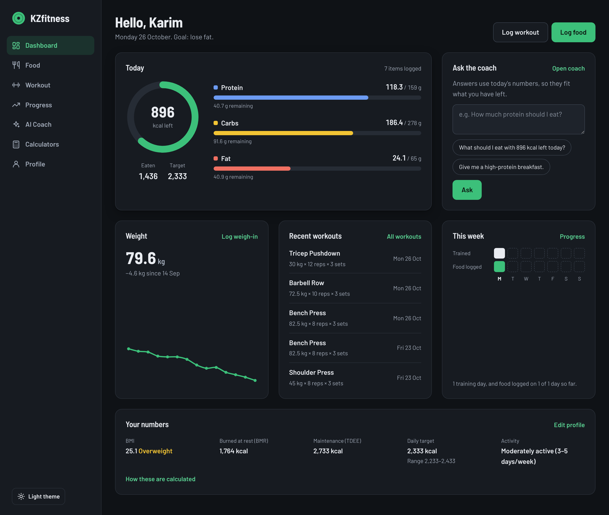
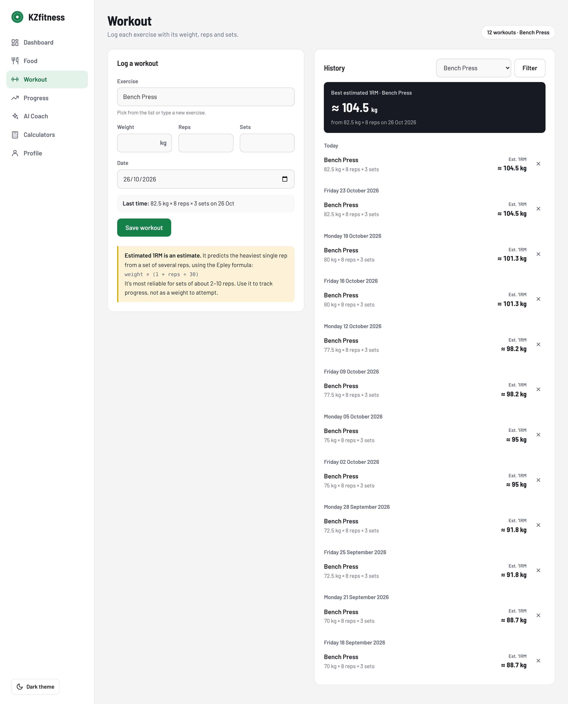
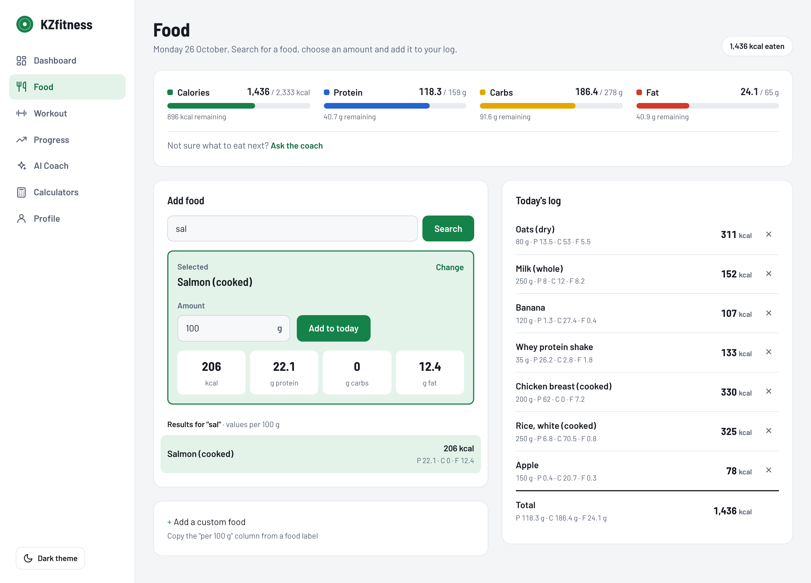
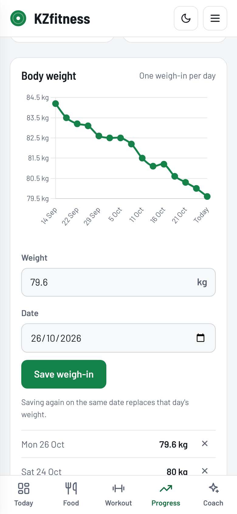
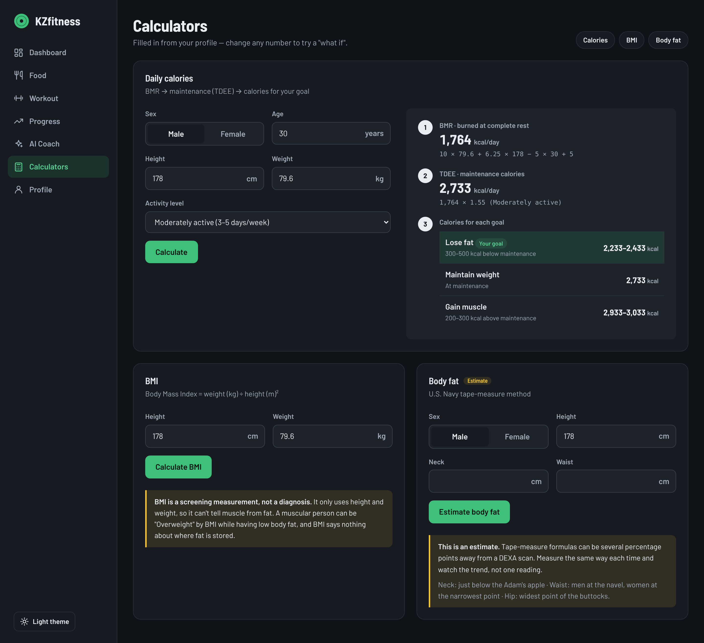
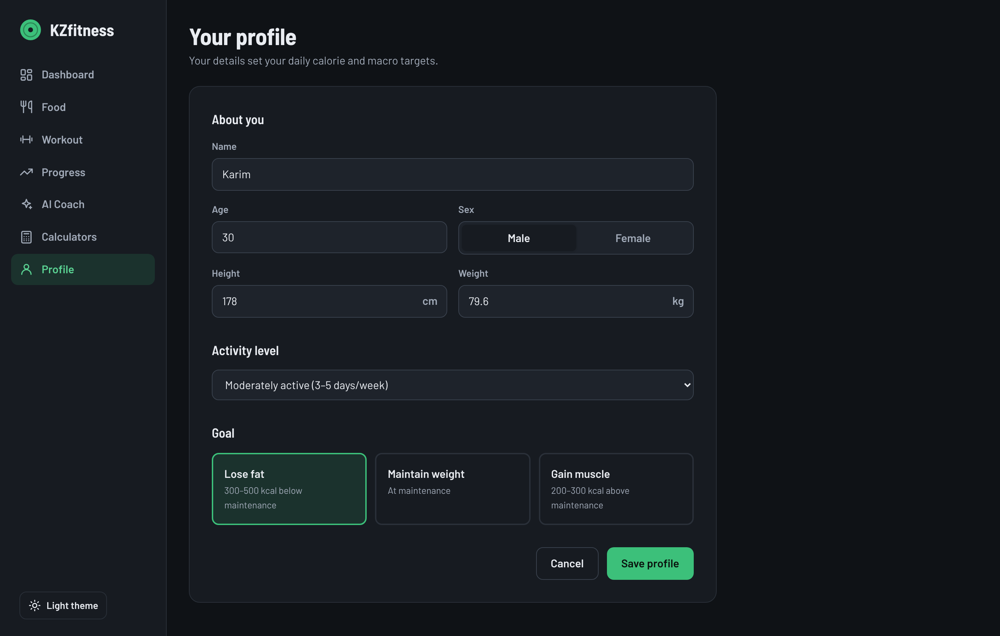

 ## KZfitness

KZfitness is a personal computer science project built around my interest in fitness and strength training. It's a web app that puts macro tracking, workout logging, and an AI fitness assistant in one place, so you don't have to keep switching between a tracker and a chatbot just to find out how many calories are in a chicken breast.

## Features

- **Macro tracking:** log daily calories, protein, carbohydrates, and fats.
- **Workout logging:** record exercises and lifts for each gym session.
- **AI fitness assistant:** ask about nutrition, calorie estimates, and workout splits.
- **Personalized guidance:** enter your age, sex, weight, and height to get recommendations that fit you.
- **Fitness calculators:** BMI, daily calorie needs, and a one-rep max calculator.
- **Progress tracking:** graphs of your nutrition and workout data over time.

## Screenshots

### Dashboard
 

### Workout

### Workout

### Food

### Progress

### AI Fitness Assistant

### Calculators

### Profile

# What I Learned

- How Python, a database, and a web page work together in one application.
- How to store and read data with SQL.
- How to organize code into separate modules.
- How to add an AI API to an app and use a person's fitness details to make its answers more relevant.

Building KZfitness showed me how computer science can solve problems I run into in my own life, and it made me want to get better at programming.

## How to Run

[Add the steps here: install the requirements, set your API key as an environment variable, and run the app.]

## My Goal

I want to publish KZfitness so other beginners can use it. First I need to keep improving the design, test every feature, and make sure the calculations and AI answers are accurate and useful.

